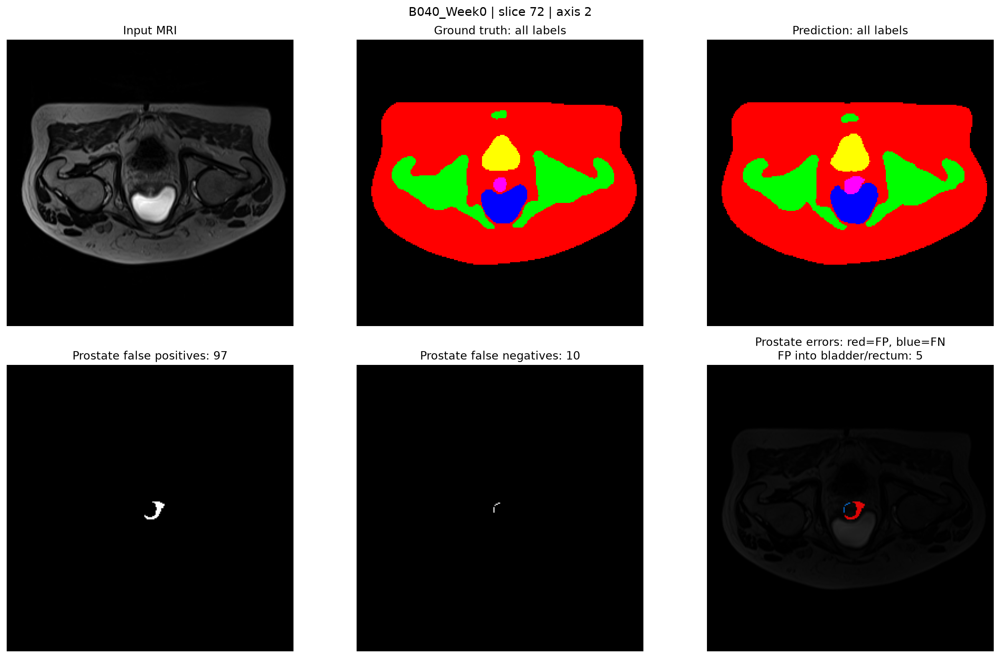
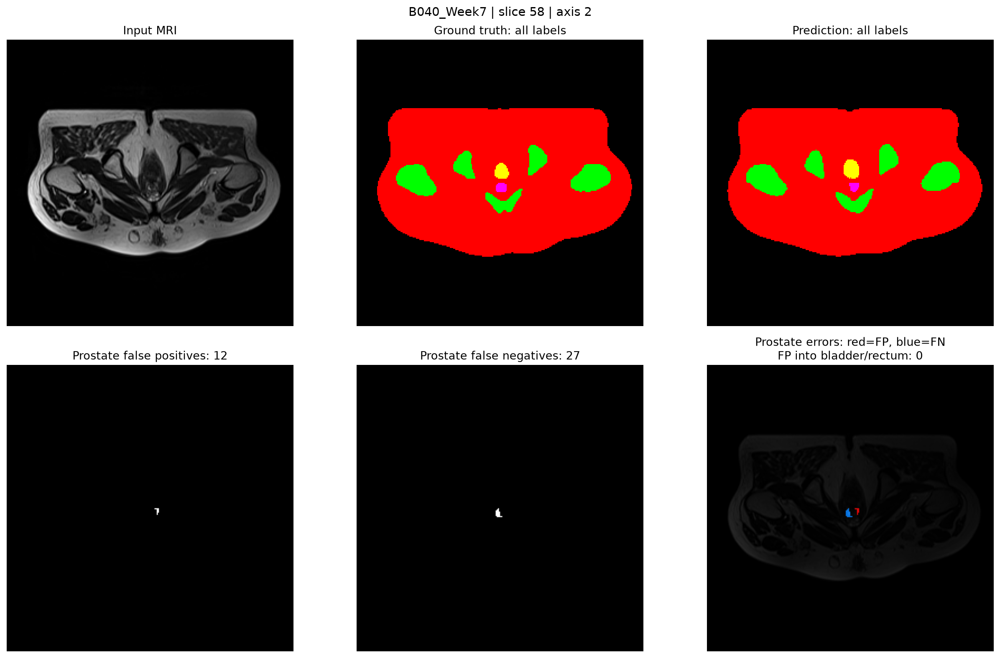
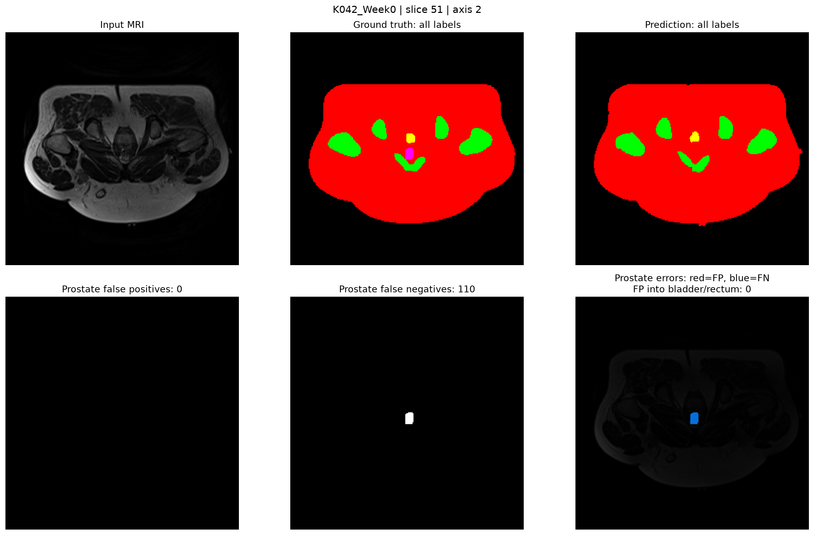

# 3D U-Net for HipMRI semantic segmentation

This project compares a patch-based 3D U-Net against an implemented 2D U-Net baseline for six class semantic segmentation of HipMRI NIfTI volumes. The segmented classes are background, body, bone, bladder, rectum and prostate. The overall objective is to assess whether volumetric context improves anatomical segmentation, especially around the prostate apex and base, while remaining feasible under the additional GPU memory usage and training time demanded by the 3D spatial context. This project serves as a research benchmark and not a clinical decision.

## Method

The primary model is a five-level 3D U-Net based on Çiçek et al. (2016). Each encoder level applies two 3x3x3 convolutions, each followed by a ReLU activation function. Four max-pooling operations are used to progressively reduce spatial dimensions and expand the receptive field. The decoder uses 2x2x2 transposed convolutions, concatenates features from corresponding encoder levels through skip connections, and applies two further convolutions per level. A 1x1x1 convolutional head produces voxel logits corresponding to six classes. Training uses a combined cross entropy and dice loss on 3D patches, and prediction averages logits over overlapping sliding windows before assigning each voxel to its most likely class.

The baseline model is a 2D U-Net based on Ronneberger et al. (2015). It processes axial slices independently, uses valid 3x3 convolutions and cropped skip connections, and predicts the same six classes as the 3D model. Both the 2D and 3D U-Nets follow the same general structure, allowing the comparison to investigate the contribution of volumetric context while accounting for differences in architecture, normalisation and model capacity.


The 3D model defaults to 16 base channels because full-width 3D feature maps require substantially more GPU memory. Use `--base-channels 64` to match the 2D baseline's channel configuration.

## Files and usage

| Location | Purpose |
|---|---|
| `dataset.py` | Validates and loads aligned 3-D NIfTI image/label pairs, normalises volumes and extracts matched patches. |
| `modules.py` | Defines `UNet3D`. |
| `train.py` | Patient-level split, training, validation, checkpointing, epoch timing, and peak CUDA-memory reporting. |
| `predict.py` | Sliding-window full-volume inference and writes NIfTI segmentation outputs. |
| `utils.py` | Computes model prediction against ground truth visualisations. |
| `baseline/dataset.py` | Loads aligned 2D axial slices and supplies the baseline 2D dataset. |
| `baseline/modules.py` | Defines the baseline 2D U-Net. |
| `baseline/train.py` | Trains and validates the 2D U-Net baseline. |
| `baseline/predict.py` | Slice-wise 2D inference and writes NIfTI segmentation outputs. |

```bash
python train.py --data-root /home/groups/comp3710/HipMRI_Study_open \
  --output checkpoints/unet3d_hipmri.pt

python predict.py --data-root /home/groups/comp3710/HipMRI_Study_open \
  --checkpoint checkpoints/unet3d_hipmri.pt --output-dir inference
```

## Pre-processing and alignment

Both pipelines use `nibabel` to load NIfTI data and preserve image-label correspondence. The 3D loader checks file existence, matching three-dimensional shapes and affine matrices, finite image and mask values, and integer labels within the range 0-5. It transposes volumes from NIfTI `[X, Y, Z]` order to PyTorch `[D, H, W]` order, applies per-volume Z-score normalisation, and extracts image and mask patches using matching coordinates. If a volume is smaller than the requested patch size, image borders are edge-padded and masks are zero-padded.

The 2D baseline check image/mask shape and affine agreement, extracts matched axial slices, applies per-slice Z-score normalisation, and creates six-chanel one-hot labels internally before converting them to integer class targets for cross entropy loss. Its valid convolutions require centre-cropping target masks to match the output dimensions.

The dataset was divided into training, validation, and test sets split by patient ID. Given the limited dataset size, 31 patients (IDS 4-35) were assigned to training, 4 patients (IDS 36-39) to validation, and 3 patients (IDS 40-42) to testing. This allocation provdes most of the available data for model training while reserving separate patients for model selection and final evaluation. Splitting by patient ID prevents data from the same patient from appearing across multiple sets, reducing data leakage risk.

## Feasibility review

### User Need, Scope & Acceptance Criteria

#### Intended User
Radiotherapy clinicians or medical image-contouring staff

#### Prototype purpose
To investigate automated segmentation of prostate-region anatomy from MRI as an aid to manual contouring, and to compare a standard 2D U-Net with a 3D U-Net to determine whether volumetric context eliminates boundary and slice-transition errors and whether it justifies the additional computational cost.

#### Acceptance criteria
 - Functional correctness: Ensuring splits by patient ids, and the model completes forward/backward passes saving checkpoints. 
 - Segmentation accuracy: Per-class Dice (DSC) and IoU on the held-out test patients for both models using the same test split. 
 - Boundary quality: prostate base, middle, apex regions, quantify boundary accuracy using HD95 or surface dice.
 - Peak VRAM: 6.9GB reserved memory
 - train time per epoch: 4.8GB allocated memory
 - per case inference time: 1 min per epoch

### Model Choice & Course Concepts

#### Dataset and model configuration
 - Dataset configuration: HipMRI dataset, 211 MRI volumes and 211 corresponding masks, six segmentation labels. 31 train, 4 validation, 3 testing split by patient ids.

#### Model architecture
2D U-net as a baseline, processing individual MRI slices, and a 3D U-Net on the same dataset with volumetric convolutions and skip connections, initial patch size of 32x128x128, 16 base channels, and batch size of 1.

#### Chosen difficulty band
Normal

#### Course concepts and literature
U-Nets, their use in semantic image segmentation and performance with small datasets, which is appropriate for the provided limited dataset and its type.
Ronneberger et al. (2015), U-Net; Çiçek et al. (2016)

### Preliminary Feasibility Evidence

#### Baseline smoke-test experiment
 - 2D smoke test: completed initial training pipeline. Peak allocated VRAM was 0.37GB, reserved VRAM was 0.46GB, best validation dice was 0.867.
 - 3D smoke test: training loss 1.23, training dice 0.17, validation loss 1.12, validation dice 0.17
### Feasibility Evidence
 - Peak 3D VRAM: 4.8GB allocated, 6.9GB reserved
 - Runtime: 1 min per epoch

### Risks, Budget & Fallback
 - Key technical risks: High 3D memory and runtime requirements, overfitting on limited patient data, severe class imbalance, and global Dice masking local boundary failures. Under-contouring may result in tumour recurrence, over-contouring may cause sever radiation toxicity.
 - Computing budget: < 2 hour train time
 - Next planned experiment: Complete a small 3D training run, profile resource use, then compare both models on the same held-out test patients. Report per-class DSC and IoU, boundary metrics, visual overlays and compare failure cases.
 - Fallback: If 3D U-Net provides insufficient benefit for its additional computational cost/if 3D U-Net is unable to be trained to an acceptable level, use the working 2D U-Net as a fallback.

## Dependencies and reproducibility

The code requires `Python`, `PyTorch`, `NumPy`, `NiBabel`, and `matplotlib`, the baseline dataset also imports `tqdm`. GPU execution requires a CUDA-compatible PyTorch installation. Training was performed on an nvidia RTX 3070 Ti GPU.

Python      3.11.15
torch       2.13.0
numpy       2.0.2
nibabel     5.4.2
matplotlib  3.11.1
tqdm        4.70.0

 - Random seed: 42, used to initialise Python, NumPy, and PyTorch random number generators.
 - Patient-level splits: Patients were assigned to training, validation, and test sets by patient ID. patients with IDs 4-35 were assigned for training, 36-39 for validation, and 40-42 for testing.
 - Training: Run python train.py with the same configuration and arguments used in this project, in /3D_UNet_s4641740 for the 3D U-Net, or /3D_UNet_s4641740/baseline for the 2D baseline U-Net
 - Inference: Run python predict.py in the same directory as train.py

## Example Input/Output

*Figure 1: Example output of model given an MRI slice input.*

This image shows an example input MRI slice, its ground-truth segmentation, and the model's predicted segmentation. The error visualisation highlights false-positive prostate predictions, where the model incorrectly labels voxels as prostate that are not prostate in the reference mask, and false-negative predictions, where the model incorrectly predicts other labels where they are prostate in the reference mask.
black   - background
red     - body
green   - bone
blue    - bladder
pink    - prostate
yellow  - rectum

## Investigation

### Quantitative Benchmarking

| Model | Per-class Dice | Per-class IoU | Boundary metric |
|---|---|---|---|
| 2-D U-Net baseline | body=0.9750, bones=0.9066, bladder=0.9587, rectum=0.8534, prostate=0.8579 | body=0.9513, bones=0.8294, bladder=0.9213, rectum=0.7471, prostate=0.7524 | prostate ASSD=1.2294mm, prostate HD95=3.4935mm |
| 3-D U-Net | body=0.9724, bones=0.8954, bladder=0.9577, rectum=0.8076, prostate=0.8752 | body=0.9463, bones=0.8111, bladder=0.9191, rectum=0.6852, prostate=0.7793 | prostate ASSD=1.0932mm, prostate HD95=3.0523mm |

The 3D U-Net achieved a slightly higher prostate Dice score (0.8752 vs 0.8579) and a lower prostate Average Symmetric Surface Distance (ASSD) and 95th-percentile Hausdorff Distance (HD95), indicating better segmentation accuracy and a closer agreement between the predicted and reference prostate boundaries.

### Resource Profiling

| Model | Parameters | Peak inference VRAM | Mean per-case inference time |
|---|---:|---:|---:|
| 2-D U-Net baseline | 1,940,902 | 0.057GiB | 0.35s |
| 3-D U-Net | 5,644,998 | 0.748GiB | 1.1s |

The 3D model has approximately 2.9 times as many parameters as the 2D baseline (5.64M vs 1.94M), uses more peak inference VRAM (0.748 vs 0.057 GiB), and takes longer per case inference (1.1 vs 0.35 seconds).

### Qualitative Error Analysis

## Failure Case 1

*Figure 2: Predicted prostate too large, leaks into bladder.*

Failure mode: over-segmentation and adjacent organ boundary leakage.

In this case, the model over-segmented the prostate, incorrectly classifying five voxels within the ground-truth bladder region as prostate. On visual inspection, the boundary between the prostate and bladder appears indistinct, potentially making it difficult for the model to distinguish between the two adjacent organs. The prediction appears to extend beyond the prostate boundary into neighbouring anatomy.

This may reflect a limitation in learning distinct anatomical features from MRI data, particularly when adjacent organs have similar intensity patterns or poorly defined boundaries. Because the model must assign a discrete class to each voxel, ambiguous boundary regions may be incorrectly classified.

## Failure Case 2

*Figure 3: Predicted prostate too small.*

Failure mode: under-segmentation with both false negative and false positive boundary voxels.

In this case, the model correctly identifies the central portion of the prostate but fails to reproduce its full extent, resulting in under-segmentation. Both false-negative voxels, where prostate tissue is missed, and false-positive voxels, where surrounding tissue is incorrectly classified as prostate, are present.

A potential explanation is that the prostate boundary is difficult to distinguish from surrounding anatomy in the MRI, causing the model to misclassify voxels near the boundary. Although the training objective combines Dice loss and cross-entropy loss to encourage accurate segmentation, these objectives do not guarantee correct classification of every boundary voxel. The error may therefore reflect the difficulty of distinguishing the prostate from neighbouring tissues rather than simply a failure to learn its central location.

## Failure Case 3

*Figure 4: Prostate not predicted at all.*

Failure mode: complete class omission.

In this case, the model fails to predict any prostate voxels despite the presence of prostate tissue in the ground-truth segmentation. Unlike the previous cases, where the model identifies at least part of the prostate but produces an inaccurate boundary, this represents a complete failure to identify the prostate on the affected slice.

One possible explanation is that the prostate's appearance at this location is insufficiently distinctive for the model to classify it correctly, resulting in the relevant voxels being assigned to background. This could be associated with ambiguous anatomical boundaries, limited representation of similar appearances during training, or difficulty recognising the prostate at this particular slice position.

This failure is particularly important for the intended contouring assistant because the prediction provides no prostate region for the clinician to refine on the affected slice. The missing structure would need to be identified and delineated manually, demonstrating that the model's output cannot always be relied upon as a starting contour.

## Recommendation

The 3D U-Net is the preferred candidate for further development as a prostate-contouring assistant, but it should be used as a clinician-reviewed drafting tool rather than an autonomous segmentation system. Across the nine held-out test volumes, it achieved a mean prostate Dice score of 0.8752, compared with 0.8579 for the 2D baseline. It also achieved lower mean prostate ASSD (1.093 mm versus 1.229 mm) and HD95 (3.052 mm versus 3.494 mm). These results suggest a modest overall improvement in prostate overlap and boundary agreement from incorporating volumetric context.

However, the improvement was not consistent across all cases or anatomical structures. The 2D model achieved higher mean Dice scores for body, bones and rectum, while bladder performance was nearly identical. Furthermore, endpoint measurements did not demonstrate a consistent advantage for the 3D model at the superior and inferior ends of the prostate. The failure cases also show that 3D predictions can still contain boundary leakage, incomplete prostate coverage and complete prostate omission. Consequently, volumetric context alone does not eliminate the anatomical failure modes relevant to radiotherapy contouring.

The trade-off is computational cost. In the tested environment, the 3D model contained approximately 5.64 million parameters compared with 1.94 million for the 2D model, used approximately 0.748 GiB of peak inference GPU memory compared with 0.057 GiB, and required approximately 1.1 seconds per case compared with 0.35 seconds.

It is recommended to retain the 3D U-Net as the primary candidate where prostate contour quality is the priority and the available hardware can support it. Its modest improvement in prostate metrics provides a reasonable basis for further evaluation, but not sufficient evidence to justify replacing the 2D baseline in every application. The 2D model remains a useful cheaper alternative.

For deployment, the proposed system should include clinician review of all generated contours, with particular attention to prostate boundaries adjacent to the bladder and rectum, incomplete coverage of the gland, and slices where the prostate is missing entirely. A practical quality-control mechanism should flag empty prostate predictions and potentially suspicious artefacts or boundary extensions for manual review rather than presenting them as reliable contours.

Overall, the results suggest that 3D volumetric context provides a modest improvement in overall prostate segmentation accuracy and boundary agreement, but does not eliminate failures near anatomical boundaries or at the prostate base and apex. Given these results, the improvement may not justify using the extra computational resources and memory compared to a 2D model. The 3D U-Net should therefore be used as a clinician-supervised contouring assistant, rather than an autonomous clinical segmentation system.

## Artificial Intelligence Usage Disclosure

ChatGPT was used in this project to assist with code scaffolding, translating the original Caffe U-Net architecture into PyTorch, debugging, and documentation drafting. All AI-assisted code was reviewed and tested, including checking data loading and patient-level data splits, verifying model training and inference execution, evaluating segmentation metrics against ground-truth masks, and inspecting logic, loss functions and visualisations to identify potential errors.

## References

1. O. Ronneberger, P. Fischer, and T. Brox, "U-Net: Convolutional Networks for Biomedical Image Segmentation," *MICCAI*, 2015.
2. Ö. Çiçek, A. Abdulkadir, S. S. Lienkamp, T. Brox, and O. Ronneberger, “3D U-Net: Learning
dense volumetric segmentation from sparse annotation,” in Proc. MICCAI, 2016.
3. HipMRI Study for MRI-alone treatment planning and other imaging. <https://doi.org/10.1016/j.ijrobp.2015.08.045>
